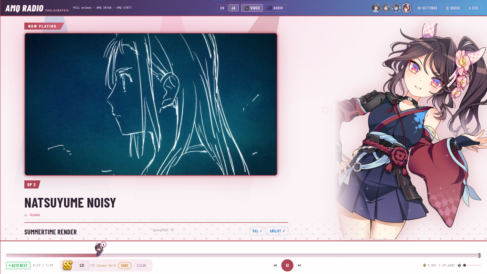
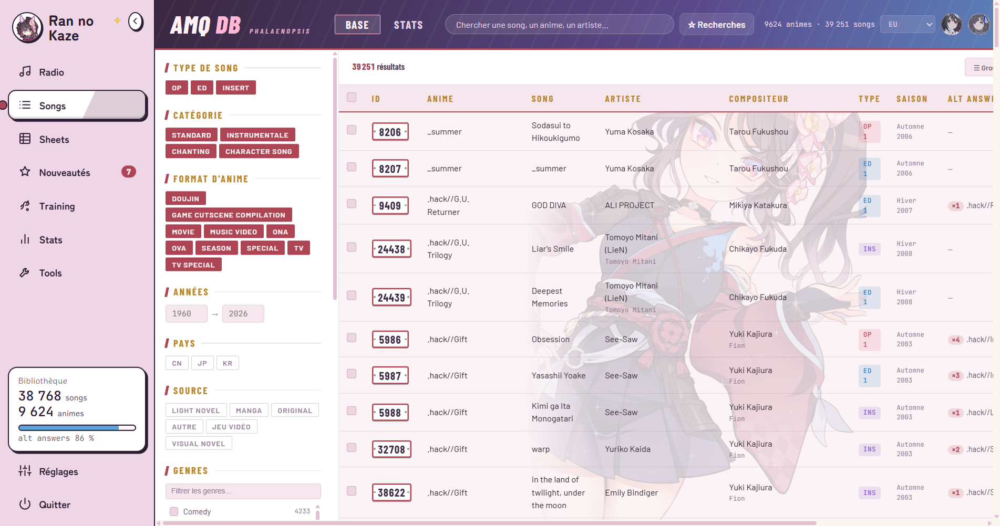
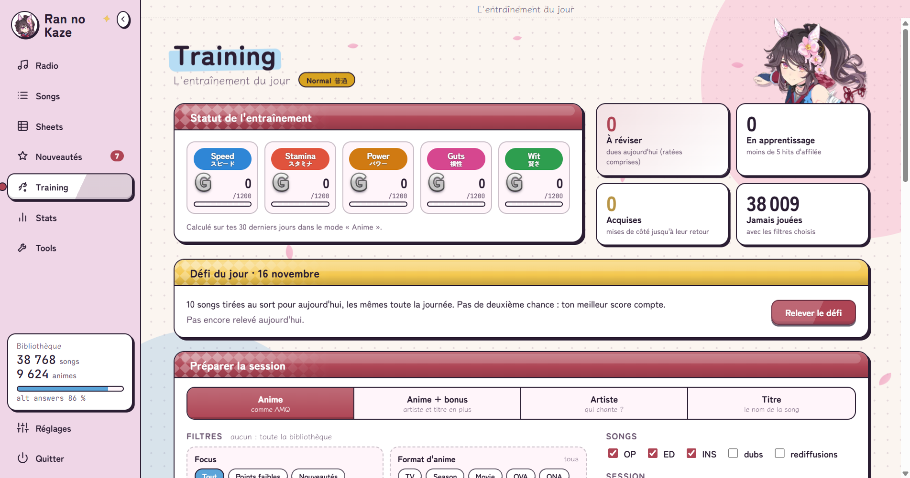
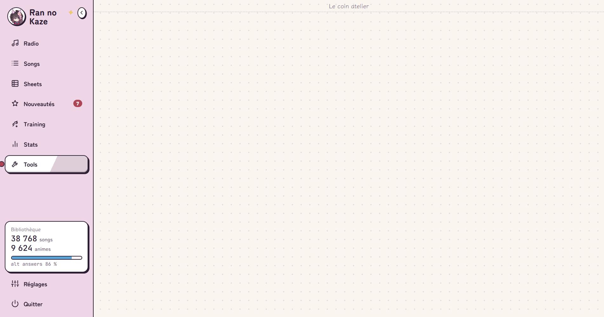

  

<h1 align="center">Ran no Kaze</h1>

  La radio, la base de données et le carnet d'entraînement des musiques d'<b>AnimeMusicQuiz</b>, réunis dans une app Windows. 
  <i>Radio, song database and training notebook for AnimeMusicQuiz songs, in one Windows app.</i>

  <a href="https://github.com/Nemesise6/Ran-no-Kaze/releases/latest"><b>⬇ Télécharger la dernière version</b></a>

<!-- 📸 À AJOUTER : une grande capture de la radio en lecture (vidéo + jaquette), le plus bel écran de l'app.
     Fichier : images/radio.png, puis décommente la ligne ci-dessous. -->
<!-- 

 -->

---

## Ce que fait l'app

- **Radio** : écoute en continu les openings, endings et inserts d'AMQ, en audio ou en vidéo, avec des filtres (années, saisons, genres, artistes…), une file d'attente et le mini-lecteur toujours au premier plan.
- **Songs** : toute la bibliothèque en tableau, avec la recherche, les filtres, les alt answers et une vue statistiques.
- **Training** : révision espacée pour reconnaître les animes, les artistes ou les titres, un défi du jour, et ta progression dans le temps.
- **Sheets** : tes notes et tes listes, l'import de party rankings, un sorter par duels, l'export en `.xlsx` ou vers Google Sheets.
- **Nouveautés et Stats** : ce qui vient d'arriver dans la bibliothèque, et le tableau de bord de toute la base.
- **4 thèmes** (Phalaenopsis, Daring Tact, Kitasan Black, Daiichi Ruby), français ou anglais, statut Discord, touches multimédia du clavier.

| Songs | Training |
|---|---|
|  |  |

| Stats | Mises à jour |
|---|---|
|  |  |

<!-- 📸 IDÉES de captures à ajouter dans images/ :
     - sheets.png : une sheet remplie avec des notes (la page est vide sur une installation neuve)
     - themes.png : les 4 thèmes côte à côte (Réglages > Thème)
     - mini.png   : le mini-lecteur posé sur le bureau
     - gif de la radio qui enchaîne deux songs -->

## Installation

1. Télécharge **`Ran-no-Kaze-Setup-x.y.z.exe`** dans la [dernière release](https://github.com/Nemesise6/Ran-no-Kaze/releases/latest), dans la partie *Assets*.
2. Lance-le. Windows va sûrement afficher **« Windows a protégé votre ordinateur »** : l'app n'est pas signée par un éditeur payant. Clique sur **Informations complémentaires**, puis sur **Exécuter quand même**.
3. Choisis le dossier d'installation, puis lance **Ran no Kaze**.

Au premier lancement, la bibliothèque (environ 9 Mo) se télécharge et s'installe toute seule. Il faut une connexion internet. Ensuite la radio, Songs et Training sont prêts.

**Configuration requise :** Windows 10 ou 11 en 64 bits, et une connexion internet pour écouter les musiques.

> ⚠️ Ne télécharge pas le fichier `library-….rnk` de la release « library » : ce n'est pas l'app. C'est la bibliothèque, que l'app récupère toute seule.

## Mises à jour

Tout se fait sans rien faire de ton côté :

- **La bibliothèque** (nouvelles songs, alt answers…) : l'app vérifie au lancement puis toutes les 6 heures. Une notification Windows te prévient quand une nouvelle version est installée. Tu peux aussi lancer la vérification à la main dans **Tools**, et la couper dans **Réglages › Automatismes**.
- **L'app** : les nouvelles versions se téléchargent en arrière-plan et s'installent quand tu quittes l'app.

## Tes données

- Tout reste **sur ton ordinateur** : tes notes, tes sheets, ton training, tes commentaires et tes réglages. Rien n'est envoyé nulle part, il n'y a ni compte ni statistiques d'usage.
- Une mise à jour de la bibliothèque **ne touche jamais** à tes données. Une sauvegarde de ta base est faite avant chaque mise à jour, et les 5 dernières sont gardées.
- **Réglages › Données** montre où se trouve ta base et permet d'en faire une copie à tout moment.
- Pour récupérer tes notes ailleurs : **Tools › Exporter mes notes** (CSV), ou depuis une sheet (`.xlsx`, copie pour Google Sheets).

## Questions fréquentes

**La radio ne lit rien.**
Vérifie ta connexion internet : les musiques sont lues en direct depuis les serveurs d'AMQ. Dans la radio, ouvre *Réglages* et choisis le serveur le plus proche de chez toi (EU, NA East ou NA West).

**L'antivirus bloque l'installeur.**
C'est le même problème que l'avertissement SmartScreen : l'app n'est pas signée. Tu peux télécharger l'installeur uniquement depuis cette page de releases.

**Comment désinstaller ?**
Paramètres Windows › Applications › Ran no Kaze › Désinstaller. Ta base n'est pas supprimée : pour la retrouver ou l'effacer, ouvre son dossier avant de désinstaller avec **Réglages › Données › Ouvrir le dossier**.

**J'ai trouvé un bug ou j'ai une idée.**
Ouvre une [issue](https://github.com/Nemesise6/Ran-no-Kaze/issues), avec une capture si possible.

## À propos

Ran no Kaze est un projet de fan, gratuit et non commercial. Il n'est **ni affilié ni approuvé** par AnimeMusicQuiz, ni par Cygames (*Uma Musume Pretty Derby*). Les musiques, vidéos et noms appartiennent à leurs ayants droit, et les illustrations des thèmes à Cygames. Le code source n'est pas publié : ce dépôt ne sert qu'à distribuer l'app et ses mises à jour.
