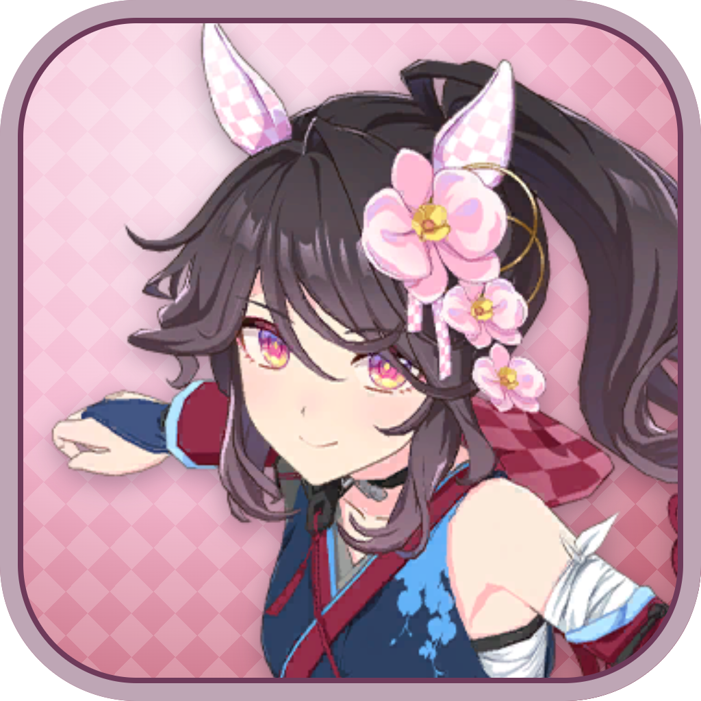
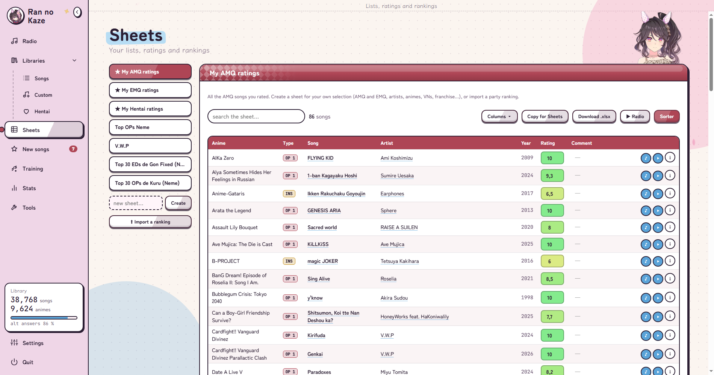
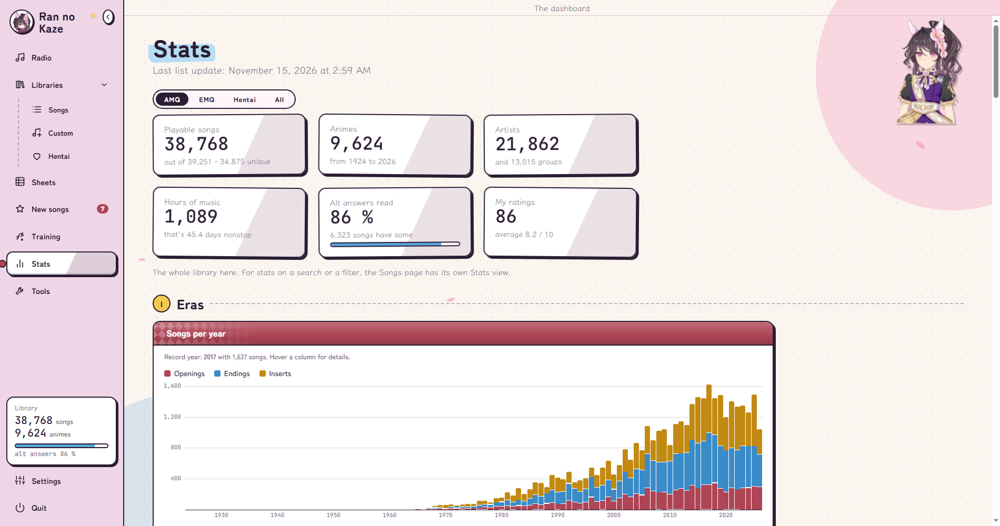

  

<h1 align="center">Ran no Kaze</h1>

  A radio, a song database and a training notebook for <b>AnimeMusicQuiz</b> songs, in one Windows app.

  <a href="https://github.com/Nemesise6/Ran-no-Kaze/releases/latest"><b>⬇ Download the latest version</b></a>

---

## What the app does

- **Radio**: plays AMQ openings, endings and inserts non-stop, as audio or video, with filters (years, seasons, genres, artists, song length, your MAL or AniList list…), a queue and an always-on-top mini player.
- **Songs**: the whole library as a table, with search, filters, alt answers and a statistics view.
- **Training**: spaced repetition to learn to recognise anime, artists or song titles, a daily challenge, and your progress over time. It can stick to the shows of your MAL or AniList list (your VNDB list for visual novels).
- **Sheets**: your ratings (one built-in sheet per library) and your own lists, party ranking import, a duel-based sorter, export to `.xlsx` or Google Sheets.
- **Custom**: your own songs that aren't on AMQ (Google Drive, YouTube, catbox or direct links), with your rating, usable in your sheets, and shareable with friends as a file or a text to paste.
- **New songs and Stats**: what just arrived in the library, and a dashboard for each library (AMQ, EMQ, Hentai) or all of them together.
- **Optional libraries (18+)**: **EMQ** (Eroge Music Quiz, songs from visual novels) and **Hentai** (songs from adult anime). They're unchecked by default: tick them in the installer, or later in Settings.
- **4 themes** (Phalaenopsis, Daring Tact, Kitasan Black, Daiichi Ruby), English or French, Discord status, keyboard media keys.

| Songs | Training |
|---|---|
|  |  |
| **Sheets** | **Stats** |
|  |  |

<!-- 📸 IDEAS for screenshots to add in images/:
     - custom.png : the Custom page with a few songs
     - themes.png : the 4 themes side by side (Settings > Theme)
     - mini.png   : the mini player on the desktop
     - a gif of the radio going from one song to the next -->

## Installation

1. Download **`Ran-no-Kaze-Setup-x.y.z.exe`** from the [latest release](https://github.com/Nemesise6/Ran-no-Kaze/releases/latest), in the *Assets* section.
2. Run it. Windows will probably show **"Windows protected your PC"**: the app isn't signed by a paid publisher. Click **More info**, then **Run anyway**.
3. Pick the install folder, choose the **optional libraries** (EMQ, Hentai), then launch **Ran no Kaze**.
4. On first launch, a window asks for your **access key** (`RNK-XXXXX-XXXXX-XXXXX`): paste it. You can also enter it later in **Settings › Libraries**.

Once the key is accepted, the libraries download and install on their own (about 9 MB for AMQ, 14 MB more for EMQ). You need an internet connection. Then the radio, Songs and Training are ready.

**Requirements:** Windows 10 or 11, 64-bit, and an internet connection to play the songs.

## Updates

Nothing to do on your side:

- **The libraries** (new songs, alt answers…): the app checks at launch and then every 6 hours. A Windows notification tells you when a new version is installed. You can also check by hand in **Settings › Libraries**.
- **The app**: new versions download in the background and install when you quit the app.

## Your data

- Everything stays **on your computer**: your ratings, sheets, training, comments and settings. There's no account and no usage statistics.
- What leaves your computer: your **access key** and a random ID for your PC when the app downloads the libraries, the username you type when you load a MAL, AniList or VNDB list (sent to that site), and your Discord status if Discord is open (it can be turned off in Settings).
- A library update **never touches** your data. A backup of your database is made before each update, and the last 5 are kept.
- **Settings › Data** shows where your database is and lets you copy it at any time.
- To take your ratings elsewhere: export a sheet (`.xlsx`, or a copy for Google Sheets).

## FAQ

**The radio doesn't play anything.**
Check your internet connection: songs are streamed live from AMQ's servers. In the radio, open *Settings* and pick the server closest to you (EU, NA East or NA West).

**My antivirus blocks the installer.**
It's the same issue as the SmartScreen warning: the app isn't signed. Only download the installer from this releases page.

**Where do I get an access key?**
Ask the author of the app. Each key is personal: it gets tied to the first PC that uses it. If you change PCs, ask for your key to be reset.

**How do I add or remove EMQ or Hentai?**
**Settings › Libraries › Extra libraries.** Ticking one downloads it, unticking removes its songs from your database.

**How do I uninstall?**
Windows Settings › Apps › Ran no Kaze › Uninstall. Your database isn't deleted: to find it or delete it, open its folder before uninstalling with **Settings › Data › Open folder**.

**I found a bug or I have an idea.**
Open an [issue](https://github.com/Nemesise6/Ran-no-Kaze/issues), with a screenshot if you can.

## About

Ran no Kaze is a free, non-commercial fan project. It is **not affiliated with or endorsed by** AnimeMusicQuiz, Eroge Music Quiz or Cygames (*Uma Musume Pretty Derby*). Songs, videos and names belong to their rights holders, and the theme artwork to Cygames. The source code isn't published: this repository only distributes the app and its updates.
